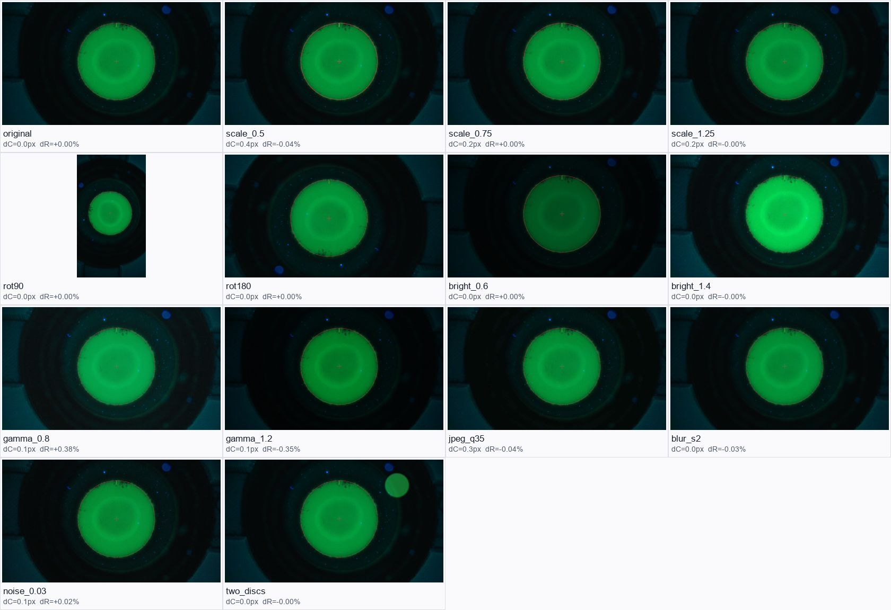
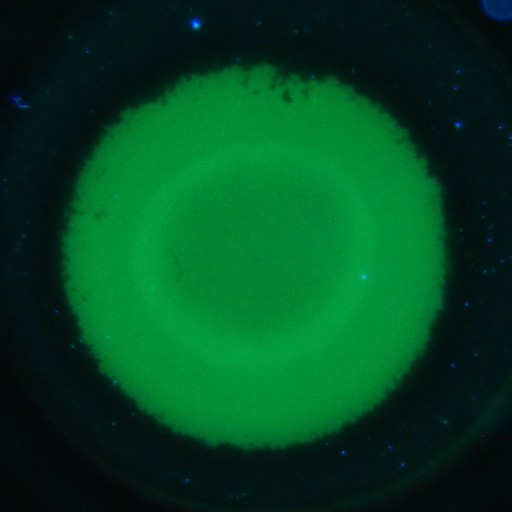
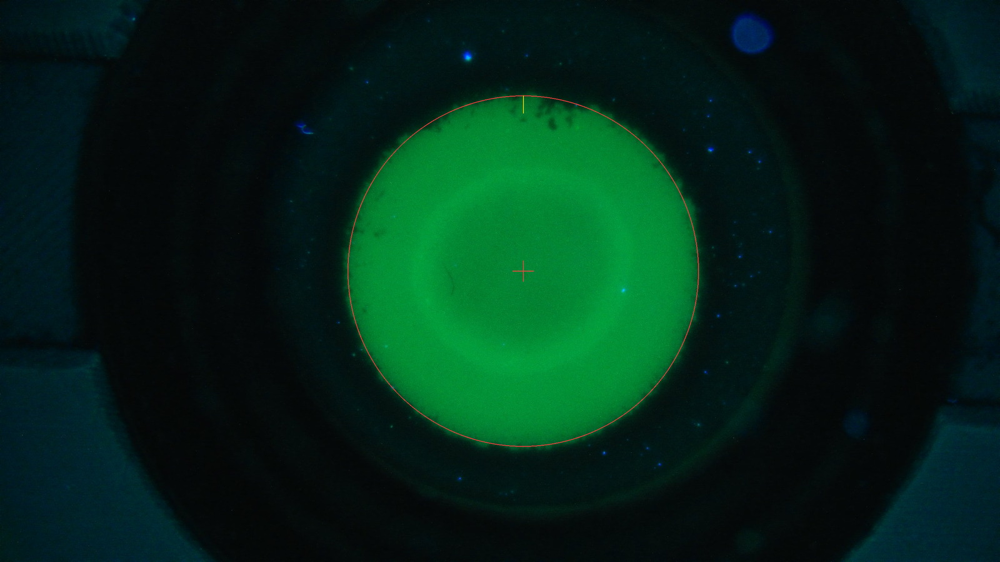

# 绿色亮圆预处理（非固定半径圆域）

当前版本：**2.0.0**（2026-11-12，清洁发布）

对荧光/暗场拍摄的绿色亮圆做批处理：自动估计每张图中亮圆的圆心与半径，按该圆域做归一化映射截取，并输出掩膜、叠加图、CSV 和可筛选的 HTML 质检报告。附带一个本地操作台：新建运行、看实时进度、翻历史记录，并从历史按钮进入交互式结果页。

适用于当前这类图像：**暗背景 + 单个绿色亮圆 + 蓝色杂散光点**，圆半径随放大倍率/孔位/对焦变化，因此半径不能写死。



---

## 操作界面（推荐）

不写命令也能用：启动本地界面，在浏览器里选目录、看进度、翻历史、逐张检查结果。

```powershell
python preprocess\serve_ui.py --port 8768
# 或直接双击：preprocess\start_ui.bat
```

浏览器打开 **http://127.0.0.1:8768/**。

界面结构：

侧栏按树状组织：**圆域提取**（新建提取 / 提取记录）与 **圆域切割**（新建切割 / 切割记录）。

- **新建运行**：添加图片文件/文件夹（内置文件夹浏览器，不依赖系统对话框）→ 扫描图片 → 指定结果输出文件夹 → 调参数（输出尺寸、margin、边缘电平、单圆/多圆、并行数）→ 开始。
- **预览 / 调参**：在开始前弹窗预览输入中的图片，可上一张/下一张逐张审核；拖动 margin、修改输出尺寸/边缘电平/目标选择后，单张结果会自动重算。点“删除当前图片”只把该图从本次运行移除（源文件保留），主界面会显示已排除数量并可一键清除。满意后“应用参数”或“应用并开始运行”。参数只影响后续运行，不会改动已完成的结果。
- **逐张删除**：预览时删除 = 从本次运行排除；运行后在结果详情底部“删除这张图” = 删除该图的结果记录并重写 CSV/报告，可分别勾选是否删除该图片的输出文件和源图片文件。删除整次运行时也可勾选是否删除输出文件夹。
- **结果输出文件夹**：主界面可直接输入或浏览选择，留空默认 `preprocess/runs`。程序会在其下创建 `<运行编号>` 子文件夹，旧结果不会被覆盖。
- **运行中**：进度条、当前文件、通过/复核/未找到计数、滚动日志；支持“取消运行”（当前正在处理的图结束后停止）。
- **运行记录**：每次运行独立保存，历史列表显示状态、图片数、圆域数、半径中位数、耗时。点 **查看结果** 进入该次运行的交互式结果页，也可以 **重新运行**（带回原参数）、打开输出目录或 **删除**。
- **结果页**：汇总卡片 + 状态筛选 + 文件名搜索 + 排序 + 分页；点任意缩略图弹出详情，可切换 **叠加图 / 归一化 ROI / 掩膜 / 极坐标**，查看半径、覆盖率、SNR、残差等指标，并左右翻页。右上角仍可打开原始 `report.html` 或下载 CSV；页面顶部有 **重新运行** 和 **删除本次运行**。
- **圆域切割**：侧栏树中进入“圆域切割 → 新建切割”，选择一条提取记录；图片列表支持多选和全选（只选当前搜索结果），批量切割时逐张保存并显示进度。
- **切割参数**：设置圆心角、输出尺寸、圆心方式（红域几何圆心 / 自动重心），生成只保留红域圆的图像，并按圆心角切成扇形。
- **切割结果**：查看圆域图、分割线图、扇形拼图；表格列出每个扇形的角度、绿色均值/中位/P10/P90 和面积占比，每行可下载单张 PNG，顶部可下载全部扇形 ZIP；切割记录可删除。

说明：

- 界面只监听 `127.0.0.1`，不会暴露到局域网；不需要 Flask/FastAPI，后端是 Python 标准库。
- 同一时间只允许一个运行，避免多进程抢 CPU；历史记录持久化在 `preprocess/runs/index.json`，服务重启后仍在（重启时未完成的运行会标为“已中断”）。
- 运行记录目录就是普通文件夹，ROI、掩膜、CSV、report 都在里面，和命令行输出完全一致。
- 命令行方式仍然保留，适合批处理脚本/服务器环境。
- 界面字体：西文 Times New Roman，中文宋体；表格内文字居中。

---

## 1. 快速开始（命令行）

```powershell
# 依赖（只需 numpy / scipy / pillow）
python -m pip install -r preprocess\requirements.txt

# 单张
python preprocess\run_preprocess.py -i "D:\实验图片\26-3-662.jpg" -o "D:\实验图片\roi_out"

# 整个目录（递归），4 进程
python preprocess\run_preprocess.py -i "D:\实验图片" -o "D:\实验图片\roi_out" --workers 4

# 一张图里有多个孔/多个亮圆
python preprocess\run_preprocess.py -i "D:\实验图片" -o "D:\实验图片\roi_out" --multi

# 只预览将要处理哪些文件
python preprocess\run_preprocess.py -i "D:\实验图片" -o "D:\实验图片\roi_out" --dry-run
```

运行结束后重点看两个文件：

- `roi_out\tables\wells.csv`：每张图/每个圆的圆心、半径、质量指标
- `roi_out\report.html`：缩略图 + 指标 + “仅复核”筛选，建议先扫一遍

单张示例结果（本仓库自带样图 `samples/26-3-662.jpg`，2730×1536）：

| 圆心 cx, cy | 半径 | 覆盖率 | SNR | 边缘软度 | 单张耗时 |
|---|---|---|---|---|---|
| 1428.50, 740.88 px | 479.28 px | 1.00 | 73 | 43.4 px | ≈0.9 s |

归一化结果（512×512，圆始终居中、直径固定为 `512/1.35 ≈ 379 px`）：



叠加图（红圈为拟合圆，十字为圆心）：



---

## 2. 输出目录

界面运行时，输出位于你指定的“结果输出文件夹”下的 `<运行编号>/`；留空则默认 `preprocess/runs/<运行编号>/`。命令行模式的 `-o` 直接作为输出根目录。

```
out/
├─ roi_norm/   512×512 PNG，圆心固定在正中，圆直径 = out_size/margin
├─ roi_raw/    原始分辨率的方形裁剪（JPG），不做缩放
├─ mask/       512×512 圆域掩膜（白=圆内）
├─ overlay/    整图 + 拟合圆 + 圆心，用于人工质检
├─ thumb/      报告用缩略图
├─ polar/      可选：极坐标展开（角度×半径），便于看边缘/方位不均匀
├─ tables/
│  └─ wells.csv
├─ report.html
└─ run_config.json  本次参数快照（复用时用于判断配置是否变化）
```

`wells.csv` 主要字段：

| 字段 | 含义 |
|---|---|
| `cx, cy` | 拟合圆心（源图像素坐标） |
| `radius, diameter` | 拟合半径/直径（源图像素） |
| `r_area` | 阈值连通域的面积等效半径，仅作参考 |
| `r_min, r_max` | 各方向边缘半径的 1%/99% 分位，反映圆度/边缘起伏 |
| `radial_cv` | 边缘半径变异系数（标准差/半径） |
| `coverage` | 360° 中成功找到边缘的比例（贴边/遮挡会降低） |
| `contrast` | 圆内平台与局部背景的对比度（0–1） |
| `snr` | 对比度 / 背景噪声 |
| `edge_width` | 边缘软度：对比度 ÷ 最大径向梯度（等效斜坡宽度，px） |
| `residual_rms` | 边缘点到拟合圆的半径残差 RMS（px） |
| `saturation` | 圆内接近 255 的像素比例（过曝提示） |
| `touches_border` | 拟合圆是否越出画面 |
| `status` | `ok` / `review` / `not_found` / `error` |
| `roi_norm, roi_raw, mask, overlay...` | 输出文件相对路径 |

`status=review` 的触发条件（可在配置里改）：覆盖率 < 0.5、SNR < 3、半径残差/半径 > 4%、边缘软度/半径 > 15%、半径 < 10 px。贴边只记 `note`，不直接判失败。

---

## 3. 算法方案

核心思路：**用“局部半高边缘”定义圆，而不是固定阈值或固定半径**。荧光圆的边缘通常有几十像素的渐变，绝对亮度会随曝光漂移，但“圆内平台与圆外背景之间的 50% 位置”是稳定的几何边界。

1. **读取**：PIL 打开，处理 EXIF 方向；8/16-bit、灰度、RGB 都转成 0–1 浮点。
2. **绿色特征**：`S = G − (R+B)/2`。绿色圆为正，蓝色杂点/中性背景接近 0 或负，天然排除图中的蓝斑。
3. **粗分割**：对 `S` 做 Otsu 阈值（失败时退到 99.5/99/98 分位），开运算 + 填洞 + 连通域，按面积/亮度选目标。只用于得到“大概在哪、多大”。
4. **初始圆**：对连通域边界像素做稳健 Kasa 圆拟合（3 次 MAD 剔除）。这比“质心 + 面积等效半径”可靠，尤其是圆被画面边缘切掉时质心会偏。
5. **径向边缘**：从初始圆心发 720 条射线，每条射线用局部平台（0.50–0.85 R）和局部背景（1.18–1.48 R）算 50% 电平，找第一次持续低于该电平的位置，线性插值到亚像素。射线在到达边缘前越出画面的会被剔除。
6. **稳健拟合**：对 720 个边缘点按 3.5×MAD 剔除离群（缺口、毛刺、反光），再做 Kasa 拟合；圆心/半径更新后重复 2–4 步，通常 2 次迭代收敛（位移 < 0.02 px）。
7. **归一化映射**：以拟合圆为基准，在源图坐标上做仿射采样：
   `u = (像素 − out_size/2) × (2·R·margin / out_size)`，
   所以源图半径 R 不管多大，映射后圆半径恒为 `out_size/(2·margin)`。先按缩放比例做高斯抗锯齿，再双线性采样。
8. **质检指标**：覆盖率、SNR、径向 CV、残差、边缘软度、饱和比例，写入 CSV/HTML。

> “非固定半径”指每张图独立估计 R；输出 ROI 的几何是固定的（圆心居中、圆径固定），便于后续 CNN/统计模型直接吃 512×512 输入。

### 为什么这样定义边缘

- 绝对亮度阈值会随曝光、增益、背景漂移；
- 固定半径无法适应不同孔位/倍率；
- 50% 局部对比度对光照梯度、JPEG 压缩、轻微离焦都不敏感；
- 圆拟合用全部 720 个方向，个别缺口（样图顶部就有暗缺口）不会把圆拉偏。

### 样图上的表现

- 顶部有一块树枝状暗缺口，底部边缘有毛刺；拟合圆仍稳定在 `R=479.3`，径向 CV 1.1%。
- 图中蓝色亮斑（右上、左侧）被绿色特征排除。
- 在 13 组变换（缩放 0.5/0.75/1.25、旋转 90/180、亮度 0.6/1.4、gamma 0.8/1.2、JPEG q35、模糊 σ=2、噪声 0.03、双圆）下，圆心最大偏差 **0.38 px**，半径最大相对偏差 **0.38%**（见 `validation/stress_results.csv`）。注意这组数字衡量的是“变换一致性”，绝对精度由下面的合成圆测试给出。

### 合成圆验证

```powershell
python -m unittest discover -s preprocess\tests -p "test_*.py" -v
```

8 项合成圆测试 + 3 项端到端/YOLO 导出测试 + 5 项 UI 后端测试 + 1 项圆域切割测试全部通过，覆盖：半径 30/120/400 px、贴边圆、亮度梯度 + 45° 缺口、双圆 + 蓝色干扰、灰度图、16-bit TIFF、归一化映射几何、纯噪声不误检，以及本地界面的运行历史/单图预览/自定义输出/排除图片/删除图片结果/扇形切割接口。已知真值的圆心误差 ≤ 2 px，半径误差 ≤ 2%。

---

## 4. 常用参数

完整参数见 `config.example.json`，可用 `--config` 覆盖，再叠加命令行参数。

| 参数 | 默认 | 说明 |
|---|---|---|
| `-i, --input` | 必填 | 图片文件或目录，可多个 |
| `-o, --output` | `preprocess_out` | 输出目录 |
| `--workers` | 4 | 并行进程数；不可用时自动回退单进程 |
| `--multi` | 关 | 每图提取全部亮圆（默认只取最大） |
| `--feature` | `green_excess` | `green_excess` / `gray` / `max_rgb` |
| `--margin` | 1.35 | 裁剪半径倍数；1.35 = 圆外留 35% 背景 |
| `--out-size` | 512 | 归一化 ROI 边长 |
| `--polar` | 关 | 输出极坐标展开图 |
| `--force` | 关 | 忽略已有结果全部重算 |
| `--limit N` | – | 只处理前 N 张（调试） |
| `--min-snr` | 3.0 | 低于此值标 review |
| `--stretch` | 关 | 预览按 99.5% 分位拉伸（16-bit 图更直观） |
| `--no-raw` | 关 | 不保存原始分辨率裁剪，省磁盘 |

输出会复用：同一输出目录、同一份配置再次运行时，只处理新增/失败的图；改了 `margin/out_size/feature/select` 等几何参数会自动忽略旧结果。

边缘定义可以按“要包多少毛边”微调：`--edge-level 0.5` 是半高；想多包一点外圈荧光可设 `0.3`，想收紧到亮核可设 `0.7`。改完看 `report.html` 的圆是否贴合即可。

---

## 5. YOLO 能不能做？

**能做，但不建议作为这套图的主方案。** 对这类“单孔、固定工位、暗背景、绿色荧光”的图，传统几何方法在精度、稳定性、成本和可解释性上都更合适；YOLO 更适合作为“多孔定位/异常筛查”的前置模块，或把本程序的自动结果蒸馏成可部署模型。

| 方案 | 半径精度 | 数据需求 | 速度 | 可解释性 | 适用场景 |
|---|---|---|---|---|---|
| 本程序（阈值 + 径向 50% 边缘 + 圆拟合） | 亚像素，~0.2–0.5 px | 0 张标注 | CPU ~1 s/张 | 每步可查，指标可解释 | 固定工位、单/少孔、批量离线 |
| YOLO detect（bbox） | 受 bbox 限制，通常 ±3–10 px | 几百张标注 | GPU 很快 | 中 | 多孔、背景多变、需要实时 |
| YOLO segment（mask） | mask 面积等效半径有阈值偏差，±1–5 px | 几百张标注 | GPU 很快 | 中 | 多孔、形状不规则、要实例分割 |
| 混合：YOLO 粗定位 → 本程序精修 | 亚像素 | 少量标注或自动伪标签 | GPU + 精修 | 高 | 多孔 + 高精度半径 |

### 为什么 YOLO 不是首选

- 圆的边界是**渐变**的，YOLO 的 bbox/mask 标签本身就要先定义“边缘在哪”；不同标注者会给出不同半径，模型学到的半径带有标签偏差。
- 该数据对比度极高、目标单一，传统方法不需要训练就能稳定工作；YOLO 需要几百张图 + 训练/调参 + GPU，收益很小。
- 传统方法输出覆盖率、SNR、残差等**可解释质检指标**，YOLO 的置信度不能直接说明“半径是否可靠”。
- 图像尺寸 2730×1536，单张 CPU 约 0.9 s；批量 1000 张 4 进程约 4–5 分钟，已经够用。

### 什么时候值得上 YOLO

- 一张图里有多个孔、孔位不固定、需要先找孔再分析；
- 拍摄背景/光照变化很大，Otsu 经常失败；
- 需要把模型部署到边缘设备、要求固定耗时；
- 想用“分类头”直接判断圆是否异常/污染，而不是只做定位。

### 推荐路线（如果确实要 YOLO）

1. 先用本程序跑完历史图片，得到 `wells.csv` 和 `status=ok` 的圆；
2. 用 `tools/yolo_export.py` 把拟合圆自动转成 YOLO 多边形/bbox 标签（无需手工标注）；
3. 人工抽查/修正 10–20% 的标签（尤其边缘模糊、贴边的图）；
4. 训练 `yolo11n-seg`（或 `yolo11s-seg`），`imgsz=1024`，100 epochs；
5. 推理时取 mask 的质心 + 面积等效半径作为初值，再调用本程序的 `refine_circle` 做 50% 边缘精修——这样既有多孔定位能力，又保留亚像素半径。

```powershell
# 1) 导出数据集（自动标签）
python preprocess\tools\yolo_export.py `
  --csv "D:\实验图片\roi_out\tables\wells.csv" `
  --out "D:\实验图片\yolo_dataset" --mode seg --val-pct 0.15

# 2) 训练（需要 pip install ultralytics）
yolo segment train model=yolo11n-seg.pt data="D:\实验图片\yolo_dataset\data.yaml" imgsz=1024 epochs=100 batch=8

# 3) 用 mask 初值 + 本程序精修（示意）
python -c "
import sys; sys.path.insert(0, r'D:\project\银离子-乙醇\preprocess')
import numpy as np
from ultralytics import YOLO
from wellprep.config import Config
from wellprep.imaging import load_rgb, feature_map
from wellprep.circle import refine_circle
from scipy import ndimage as ndi

model = YOLO(r'runs/segment/train/weights/best.pt')
res = model.predict(r'D:\实验图片\26-3-662.jpg', imgsz=1024, conf=0.25, retina_masks=True)[0]
m = res.masks.data[0].cpu().numpy() > 0.5
ys, xs = np.nonzero(m)
rgb, _ = load_rgb(r'D:\实验图片\26-3-662.jpg')
score = ndi.gaussian_filter(feature_map(rgb, 'green_excess'), 1.2)
fit = refine_circle(score, xs.mean(), ys.mean(), np.sqrt(m.sum()/np.pi), Config())
print(fit.cx, fit.cy, fit.r)
"
```

导出器用法：

```powershell
python preprocess\tools\yolo_export.py --help
```

> 说明：`data.yaml` 的 `path` 使用绝对路径，换机器后需改路径；导出的标签是“拟合圆”的几何标签，不是人工像素级标注，适合做伪标签/预训练，正式训练前建议抽查。

---

## 6. 文件说明

```
preprocess/
├─ serve_ui.py                本地界面服务入口
├─ start_ui.bat               Windows 双击启动（自动开浏览器）
├─ run_preprocess.py          命令行入口
├─ requirements.txt
├─ config.example.json        全部默认参数
├─ web/                       界面前端（HTML/CSS/JS，无构建步骤）
│  ├─ index.html
│  ├─ app.css
│  └─ app.js
├─ runs/                      界面运行历史与每次运行的输出
│  ├─ index.json
│  └─ <run-id>/               roi_norm / mask / overlay / tables / report.html
├─ cuts/                      圆域切割历史
│  ├─ index.json
│  └─ <cut-id>/               circle / overlay / contact_sheet / sectors / sectors.csv
├─ wellprep/
│  ├─ config.py               参数与校验
│  ├─ imaging.py              读图、绿色特征、Otsu
│  ├─ segment.py              阈值粗分割 + 连通域
│  ├─ circle.py               边界初始圆 + 径向 50% 边缘 + 稳健拟合
│  ├─ render.py               归一化映射、原始裁剪、掩膜、叠加、极坐标
│  ├─ pipeline.py             单图流程 + 输出
│  ├─ runner.py               带进度/取消的批处理
│  ├─ cutter.py               圆域遮罩、自动重心、按圆心角扇形切割
│  ├─ cuts.py                 切割历史/文件存储
│  ├─ report.py               HTML 质检报告
│  ├─ webapp.py               本地 HTTP API + 运行/切割历史
│  └─ cli.py                  命令行批处理、CSV、复用
├─ tests/                     合成圆/端到端测试
├─ tools/
│  ├─ stress_test.py          真实图 13 种变换压力测试
│  └─ yolo_export.py          YOLO 数据集导出
├─ samples/26-3-662.jpg
├─ out_demo/                  样图输出（512 ROI、叠加图、CSV、报告）
└─ validation/                压力测试结果与拼图
```

---

## 7. 限制与排查

- **只适用于“亮圆在暗背景”**。如果是暗圆亮背景，需要反转特征或换方法；`--feature gray` 只改变通道，不改变极性。
- 两个圆如果相互接触/重叠，阈值会连成一个连通域；`--multi` 只能分开不相连的圆。重叠圆需要分水岭或实例分割（YOLO-seg 可以）。
- 圆被画面切掉超过一半时，圆心在数学上病态，结果会标 `review`；请补拍或接受较大不确定度。
- 全饱和（圆内大面积 255）会丢失边缘渐变，`saturation` 会升高；此时 50% 边缘仍可用，但半径不确定度变大。
- 如果 Otsu 把大面积绿色背景也算进来，可试：
  `--threshold-mode percentile --threshold-percentile 99.5`
  然后看 `report.html` 是否恢复正常。
- 16-bit 图按 12/16-bit 归一化后分析，跨位深的绝对强度不可直接比较；做强度统计前请统一曝光/位深。
- 并行进程依赖系统管道；若被安全软件/沙箱拦截，程序会自动回退单进程，只是慢一些。

---

## 8. 复现验证

```powershell
# 合成圆（已知真值）
python -m unittest discover -s preprocess\tests -p "test_*.py" -v

# 真实图的 13 种变换（输出 validation/）
python preprocess\tools\stress_test.py
```

样图批处理：

```powershell
python preprocess\run_preprocess.py -i preprocess\samples -o preprocess\out_demo --workers 1 --polar
```


## 扇区方向矫正输出

新建切割自动生成 `sectors_aligned/`，保留原 `sectors/`。矫正图的圆心位于画布中心，原图顺时针扇区的终止边旋转至 +x，选中域沿逆时针展开，无镜像。采用原图直接采样、降采样抗锯齿、双线性插值，再施加黑色扇形掩膜。输出沿用 8 位 RGB PNG，不宣称保留高位深定量信息。

选择“几何圆心”可保持提取圆心；选择“自动重心”时，两套输出都会沿用该重心。用于统一模型输入建议使用几何圆心。张角不超过 90° 才全部位于第一象限；大于 90° 不会被强行压缩。末尾不足整份的扇区按实际张角导出，见 CSV 的 aligned_end_deg。

界面结果页支持“方向矫正拼图”及逐张查看/下载；扇形 ZIP 含 sectors_aligned 子目录、CSV 与变换元数据 cut.json。旧记录需重新切割才能生成新输出，统计列仍对应原位置扇区。训练请使用单张矫正图，不使用带文字的拼图。

扇区文件名保留原图主文件名并追加原始角度范围，如 `26-2-1162-000-015deg.png`。方向矫正图采用相同文件名，存于 `sectors_aligned/`。切割输出默认在程序 `cuts/<切割编号>/`，与提取时选择的输出目录分开；切割结果页显示完整路径，并提供“输出目录”按钮。
